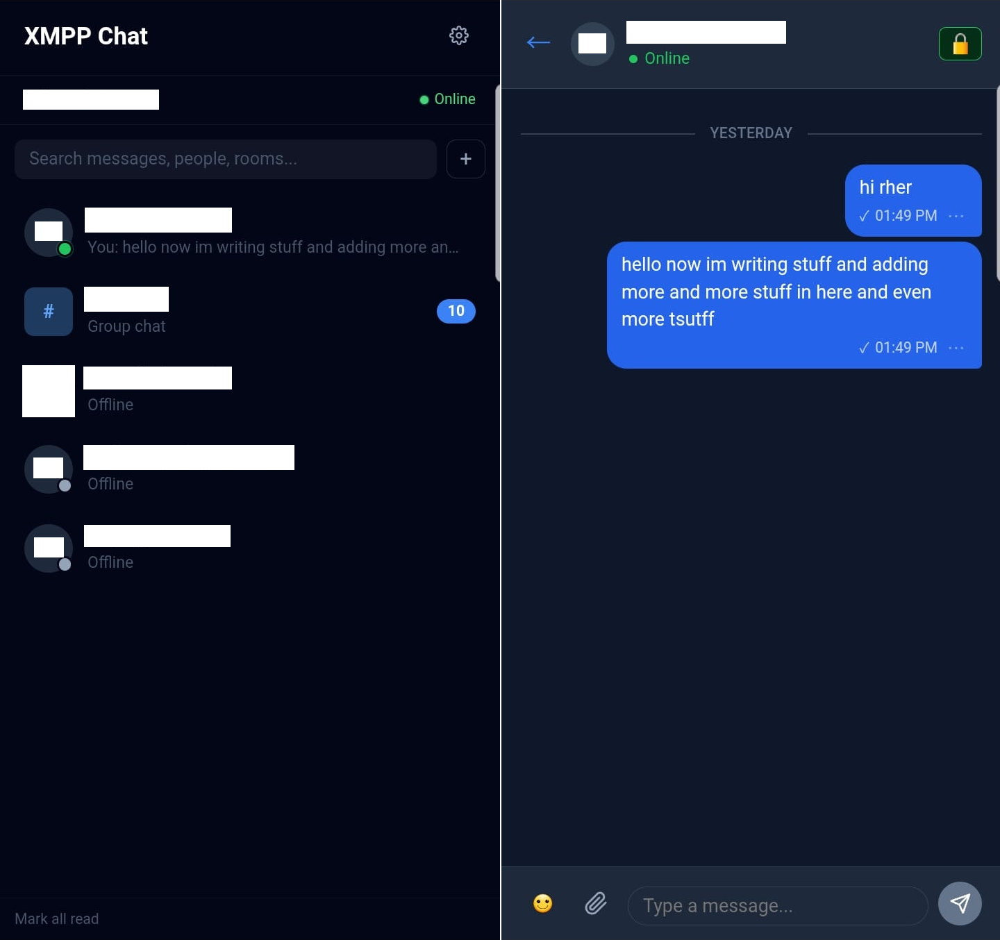

## a vibecoded XMPP client

Yet another XMPP client. It wraps Converse.js so XMPP servers that only expose HTTP ports and not the usual ports work fine with this. There are mobile builds under "Releases".

